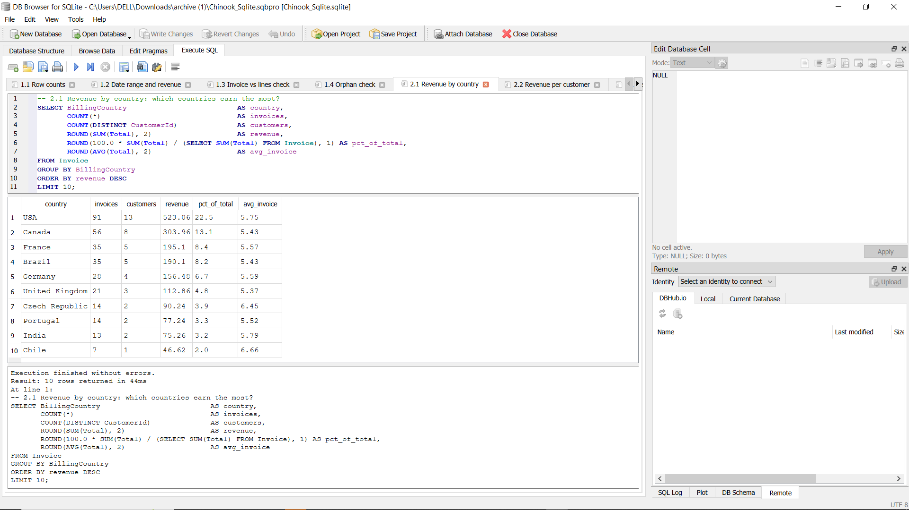
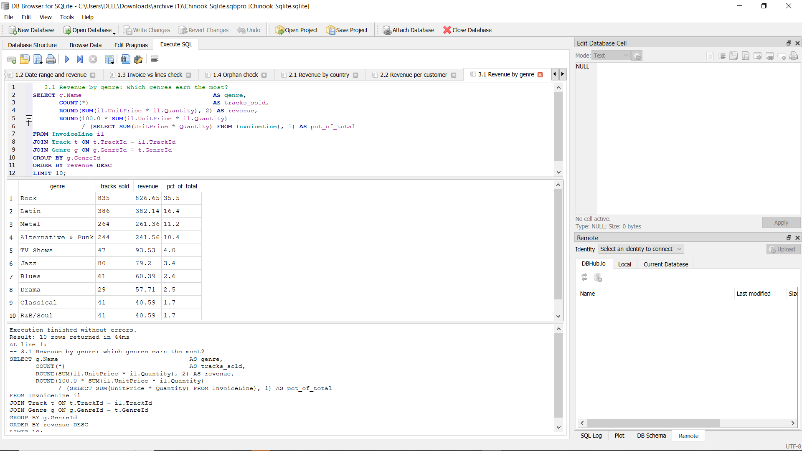
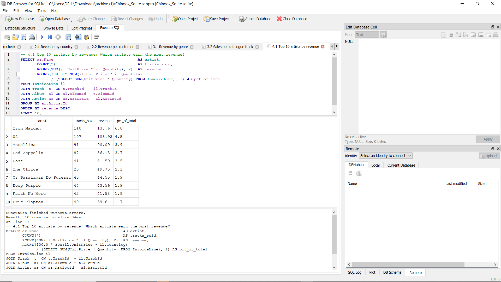
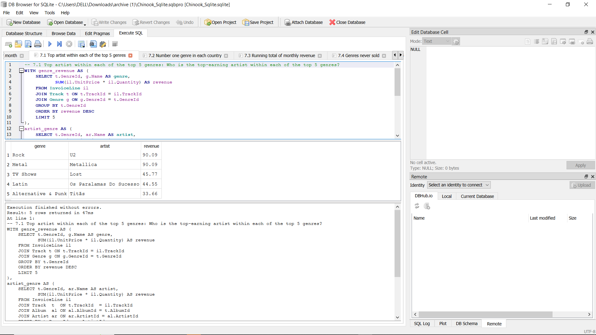

# 🎵 Chinook Music Store: SQL Revenue Analysis

Analysing a digital music store database with SQL to find which artists, genres and countries earn the most. 23 queries, 7 steps, one clear answer: **Rock and the USA lead, and 43.4% of the catalogue has never been sold.**

## 📌 Project Overview

Chinook is a sample database of a digital music store: customers buy tracks, and each purchase is stored as an invoice. This project asks one business question:

> **Which artists, genres and countries earn the most?**

I checked the data first, then analysed revenue by country, genre, artist, customer and time, and finished with advanced queries (CTEs, window functions and subqueries).

| | |
|---|---|
| Revenue analysed | $2,328.60 |
| Period | 1 Jan 2009 to 22 Dec 2013 |
| Invoices | 412 |
| Customers | 59, in 24 countries |
| Catalogue | 3,503 tracks from 275 artists |

## 🛠️ Tools Used

- **SQLite** (database)
- **DB Browser for SQLite** (running and checking queries)
- **SQL:** JOINs, GROUP BY, subqueries, CTEs, window functions (`RANK`, `LAG`, running `SUM() OVER`) and date functions

## 🗂️ Database Schema

The database has 11 tables. This project uses the 8 below; `Employee`, `Playlist` and `PlaylistTrack` are not needed for revenue questions.

| Table | Rows | What it holds |
|---|---|---|
| `Customer` | 59 | Customer name and country |
| `Invoice` | 412 | One row per purchase: date, billing country, total |
| `InvoiceLine` | 2,240 | One row per track bought: price and quantity |
| `Track` | 3,503 | Track name, genre, media type, price |
| `Album` | 347 | Album, linked to an artist |
| `Artist` | 275 | Artist name |
| `Genre` | 25 | Genre name |
| `MediaType` | 5 | Audio or video format |

How the tables connect for revenue questions:
`InvoiceLine` → `Track` → `Album` → `Artist`, and `InvoiceLine` → `Track` → `Genre`, and `InvoiceLine` → `Invoice` → `Customer`.

## ❓ Business Questions

The 23 queries are grouped into 7 steps. Every query in `sql/queries.sql` starts with a comment that states its question.

| Step | Topic | Queries | Example question |
|---|---|---|---|
| 1 | Data check | 4 | Do invoice totals match the sum of their invoice lines? |
| 2 | Country | 2 | Which countries earn the most per customer? |
| 3 | Genre | 2 | Which genres sell best for the size of their catalogue? |
| 4 | Artist | 3 | What share of revenue do the top 10 artists hold? |
| 5 | Customer | 4 | Do customers come back? |
| 6 | Time trend | 3 | Is there a seasonal pattern? |
| 7 | Advanced | 5 | Who is the top artist within each of the top 5 genres? |

## 💡 Key Insights

1. **The USA and Canada earn 35.5% of revenue.** The USA made $523.06 (22.5%), Canada $303.96 (13.1%) and France $195.10 (8.4%).
2. **Rock is the number one genre.** It earned $826.65, which is **35.5% of revenue** and **37.3% of all tracks sold** (835 of 2,240). Rock, Latin, Metal and Alternative & Punk together earn 73.5%.
3. **Rock tops 22 of 24 countries**, so its lead is not just a USA effect.
4. **Revenue is spread across many artists.** Iron Maiden leads with $138.60 (6.0%), followed by U2 ($105.93) and Metallica ($90.09). The top 10 artists earn 31.0%.
5. **43.4% of the catalogue has never been sold:** 1,519 of 3,503 tracks, and the Opera genre has no sales at all. This is the biggest opportunity.
6. **TV shows earn more per sale.** Video tracks cost $1.99 instead of $0.99, so *Lost* and *The Office* rank 5th and 6th among artists.
7. **Revenue is flat.** It stays between $449 and $481 a year, with no clear growth and no seasonal pattern (monthly revenue $186 to $201).

### ⚠️ Limitations

- Chinook is a **sample dataset**. All 59 customers bought 6 or 7 times and spent $36.64 to $49.62, which is more uniform than a real store, so these results say nothing about real loyalty or churn.
- The data ends on 22 December 2013, so the 5.6% drop in 2013 is partly an incomplete year.
- 15 of the 24 countries have only one customer, so per-customer comparisons by country are weak.

## 🔍 Sample Queries and Results

### Revenue by country (query 2.1)

```sql
SELECT BillingCountry                          AS country,
       COUNT(*)                                AS invoices,
       COUNT(DISTINCT CustomerId)              AS customers,
       ROUND(SUM(Total), 2)                    AS revenue,
       ROUND(100.0 * SUM(Total) / (SELECT SUM(Total) FROM Invoice), 1) AS pct_of_total,
       ROUND(AVG(Total), 2)                    AS avg_invoice
FROM Invoice
GROUP BY BillingCountry
ORDER BY revenue DESC
LIMIT 10;
```



### Revenue by genre (query 3.1)

```sql
SELECT g.Name                                   AS genre,
       COUNT(*)                                 AS tracks_sold,
       ROUND(SUM(il.UnitPrice * il.Quantity), 2) AS revenue,
       ROUND(100.0 * SUM(il.UnitPrice * il.Quantity)
             / (SELECT SUM(UnitPrice * Quantity) FROM InvoiceLine), 1) AS pct_of_total
FROM InvoiceLine il
JOIN Track t ON t.TrackId = il.TrackId
JOIN Genre g ON g.GenreId = t.GenreId
GROUP BY g.GenreId
ORDER BY revenue DESC
LIMIT 10;
```



### Revenue by artist (query 4.1)

```sql
SELECT ar.Name                                    AS artist,
       COUNT(*)                                   AS tracks_sold,
       ROUND(SUM(il.UnitPrice * il.Quantity), 2)  AS revenue,
       ROUND(100.0 * SUM(il.UnitPrice * il.Quantity)
             / (SELECT SUM(UnitPrice * Quantity) FROM InvoiceLine), 1) AS pct_of_total
FROM InvoiceLine il
JOIN Track  t  ON t.TrackId  = il.TrackId
JOIN Album  al ON al.AlbumId = t.AlbumId
JOIN Artist ar ON ar.ArtistId = al.ArtistId
GROUP BY ar.ArtistId
ORDER BY revenue DESC
LIMIT 10;
```



### Top artist within each genre (query 7.1, CTEs and `RANK()`)

This query uses three CTEs and a window function, so the full code is in [`sql/queries.sql`](sql/queries.sql) (query 7.1).



## ▶️ How to Run

1. Download [`data/Chinook_Sqlite.sqlite`](data/Chinook_Sqlite.sqlite).
2. Open it in [DB Browser for SQLite](https://sqlitebrowser.org/) (File → Open Database).
3. Go to the **Execute SQL** tab and open [`sql/queries.sql`](sql/queries.sql) (File → Open SQL file).
4. Select one query and press **Ctrl + Enter** to run it.

## 📁 Project Structure

```
sql-chinook-revenue-analysis/
├── README.md
├── Query_Results.pdf
├── data/
│   └── Chinook_Sqlite.sqlite
├── sql/
│   └── queries.sql
└── images/
    ├── revenue_by_country.png
    ├── revenue_by_genre.png
    ├── revenue_by_artist.png
    └── top_artist_per_genre.png
```

## 📄 Full Results

📄 [View all 23 queries with their outputs](Query_Results.pdf)

## 📚 Dataset

Chinook sample database ([source on GitHub](https://github.com/lerocha/chinook-database)), downloaded from Kaggle. It covers a fictional digital music store, so the findings describe this sample only.

## 👤 Author

**Imanathul Reyyan**, BSc Applied Data Analytics, University of Colombo

🌐 [Portfolio](https://imanathulreyyan.github.io) | 💼 [LinkedIn](https://www.linkedin.com/in/imanathul-reyyan)
